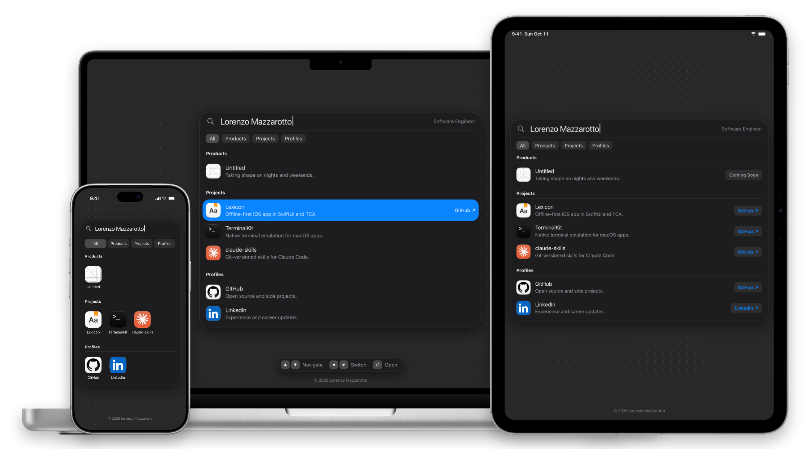

# mazzsva.com

My personal website, in the style of macOS Spotlight.



## Technologies

<table>
  <tr><td><b>Languages</b></td><td>HTML, CSS, JavaScript</td></tr>
  <tr><td><b>Hosting</b></td><td>Cloudflare Workers</td></tr>
  <tr><td><b>Testing</b></td><td>Node test runner, Playwright</td></tr>
</table>

No build step and no runtime dependencies.

## Quality

- **Loading:** The page fades in once, when it is complete, and nothing moves after.
- **Motion:** 60 frames per second on a CPU four times slower, and Reduce Motion support.
- **Layouts:** A list on Mac and iPad, and a grid of icons with a sheet on iPhone.
- **Keyboard:** The arrow keys move through the results, and Return opens a link.
- **Security:** A strict Content Security Policy, HSTS, and no cookies or third-party scripts.
- **Tests:** 128 tests check the page on Mac, iPad, and iPhone, with screenshots.

## Commands

```
npm install
npx playwright install
npm start
npm test
npx wrangler deploy
```

Copyright © 2026 Lorenzo Mazzarotto
