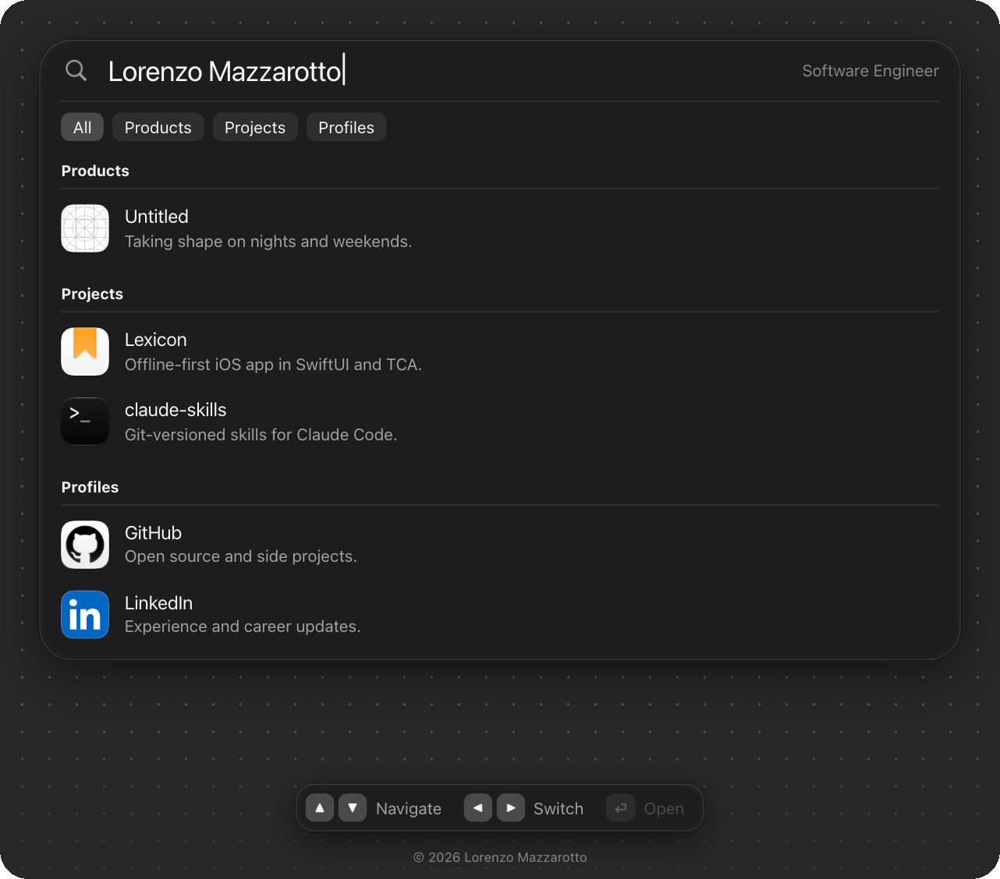

# mazzsva.com

My personal website, in the style of macOS Spotlight.


## Technologies

<table>
  <tr><td><b>Languages</b></td><td>HTML, CSS, JavaScript</td></tr>
  <tr><td><b>Hosting</b></td><td>Cloudflare Workers</td></tr>
  <tr><td><b>Testing</b></td><td>Node test runner</td></tr>
</table>

No build step and no dependencies.

## Quality



- **Loading:** The page waits until its layout is final and its images are ready, then fades in once. Nothing moves after it appears.
- **Motion:** Every animation keeps 60 frames per second on a CPU slowed down four times, and the page respects Reduce Motion.
- **Layouts:** A list on Mac and iPad, and a grid of icons with a sheet on iPhone.
- **Keyboard:** The arrow keys move through the results and the filters, and Return opens the selected link.
- **Security:** A strict Content Security Policy, HSTS, and no cookies or third-party scripts.
- **Tests:** 12 tests cover the state of the page.

## Commands

```bash
npm start
npm test
npx wrangler deploy
```

Copyright © 2026 Lorenzo Mazzarotto
